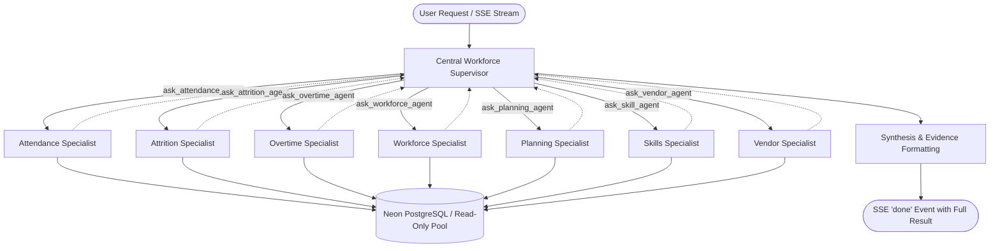

# Agent Architecture

The Workforce Intelligence Assistant uses a hierarchical Multi-Agent architecture grounded in Neon PostgreSQL.

## Architecture Overview

1. **Central Supervisor**: Receives user query, orchestrates multi-agent decomposition, delegates to domain specialists via `ask_<domain>_agent` tools, and synthesizes cross-domain findings.
2. **Specialist Agents**: Seven focused agents (Workforce, Attendance, Attrition, Overtime, Planning, Skill & Training, Vendor) with domain-specific SQL tools and analytical models.
3. **Tool Execution Loop**: Each agent runs an iterative reasoning loop (`AGENT_MAX_STEPS=4`) with strict timeout deadlines and deterministic SQL execution on Neon PostgreSQL.

## Timeouts & Deadlines

- **`AGENT_TOTAL_TIMEOUT_SEC` (default: 60s)**: Overall timeout for single-domain agent workflows.
- **`AGENT_CROSS_DOMAIN_TIMEOUT_SEC` (default: 100s)**: Total timeout budget for cross-domain supervisor queries invoking multiple specialist tools.
- **`AGENT_LLM_TIMEOUT_SEC` (default: 30s)**: Strict per-invocation timeout for LLM inference calls.
- **`DOMO_TIMEOUT` (default: 30s)**: Timeout for Domo conversational service layer.

## Partial Answers & Fallback

If an agent or tool encounters a timeout or internal error:
- The execution context captures all successfully retrieved evidence and metrics.
- The stream guarantees a final `done` SSE event containing a polite user-facing answer and data limitations disclaimer rather than failing with an unhandled exception or bare `error` event.
- Non-blocking heartbeats (`Still working...`) are emitted every 10s during long computations to keep the HTTP SSE connection active.

## Safety & System Limits

- **Read-Only Database Enforcement**: All SQL queries executed by tools run strictly against a PostgreSQL connection with transaction-level `READ ONLY` access or a dedicated read-only role.
- **Maximum Step Limit (`AGENT_MAX_STEPS=4`)**: Prevents circular tool calling and run-away loops.
- **Structured Logging**: `[TOOL_CALL]` and `[TIMEOUT]` logs capture `agent_id`, `tool`, `duration_ms`, `ok`, and `error` without logging PII, employee names, or tool data payloads.

